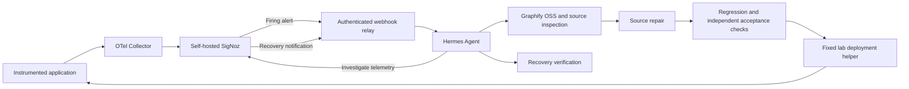

# Self-Heal

A modular self-healing application lab connecting OpenTelemetry, self-hosted SigNoz, Hermes Agent and Graphify OSS.

The project demonstrates a complete loop: an application fault produces telemetry, SigNoz sends an alert, Hermes investigates the affected code, makes a repair, runs tests, deploys to an approved lab target, and verifies recovery. Incident Live shows the recorded stages in SigNoz.

**Status:** working personal demonstration with verified lab repair cycles. This is not a production-ready autonomous remediation platform or a turnkey installer. Paths, endpoints and live rule IDs now use shared configuration; see [SETUP.md](SETUP.md).

Agents helping with explanation or setup should start with [AGENTS.md](AGENTS.md).

## How it works

Alerts go directly through the relay to Hermes; Slack or Telegram is not required by the implemented flow. Hermes uses SigNoz MCP for telemetry investigation and Graphify MCP for code relationships. The current model configuration is GPT-6.1 SOL with medium reasoning via the openai-codex provider.

## Modules

| Module | Implemented purpose |
|---|---|
| [OTel Demo](modules/otel-demo/README.md) | Integration notes for the separate instrumented application checkout. |
| [Fault explorer](modules/fault-explorer/README.md) | Historical design exploration; the implemented runner is the fault-injector module. |
| [SigNoz](modules/signoz/README.md) | Self-hosted observability integration; the demo exports telemetry through its Collector. |
| [Hermes](modules/hermes/README.md) | Authenticated alert delivery, telemetry/code investigation, regression checks, fixed lab deployment helpers and recovery verification. |
| [Graphify](modules/graphify/README.md) | Local OSS code graph, MCP access and exploratory comparison results. |
| [Incident Live](modules/incident-live/README.md) | Native SigNoz dashboard and evidence adapter for alert receipt, investigation, patches, tests, deployment and recovery; incident counters and stage timings. |
| [Fault injector](modules/fault-injector/README.md) | Random service and compatible source-mutation selection, qualification before rollout, bounded observation and cleanup. |
| [Availability](modules/availability/README.md) | Scheduled lab requests, independent TCP checks, monitor heartbeats and missing-span alerts. |
| [Simulithic](modules/simulithic/README.md) | CLI preparation only; hosted access and end-to-end testing integration remain pending. |

The upstream OTel Demo, SigNoz, Hermes and Graphify installations are kept outside this repository. This repository holds our integration code, configuration, tests, documentation and selected evidence—not vendored copies of those products or their runtime data.

## Fault injection and monitoring

The injector supports nine source transformations across three repair labs:

| Service | Source fault families |
|---|---|
| Payment (JavaScript) | Four card-validation and expiry-condition mutations. |
| Recommendation (Python) | Sampling overflow, invalid catalog method and blocking delay. |
| Quote (PHP) | Invalid response method and blocking delay. |

These are bounded mutation rules applied directly to code, without enabling demo feature flags. Candidates must pass syntax checks, start and produce a detectable runtime effect before injection. This does not generate arbitrary bugs in arbitrary applications. Installed injector files and records use root-only access; broad Docker access means the setup is not a strict blind-investigation boundary.

Seven SigNoz rules are configured: one original main-demo Payment rule, three lab error/latency rules, and three lab availability rules. Availability checks run every 30 seconds. A rule detects no successful TCP probes or no checker records for two minutes, or no expected server spans for five minutes. SigNoz's evaluation delay and notification scheduling add to these durations. Scheduled requests prevent normally idle labs from being mistaken for telemetry failures.

## What we verified

- **Payment:** Hermes reproduced four failing regression tests, repaired the source, passed all 11 tests in two time zones, deployed and processed recovery without human approval. Continuing traffic recorded 318 successful post-deployment calls. [Full drill](modules/hermes/automatic-drill-2026-10-20.md).
- **Recommendation and Quote:** Hermes repaired a catalog-call error and a latency defect, passed independent candidate/live checks, deployed and processed real recovery notifications. Post-deployment traffic recorded 165 and 174 successful calls respectively, with zero failures. Recommendation validation included coordinator fixes to alert detection and credential loading; it is not an uninterrupted performance benchmark. [Multi-service validation](modules/fault-injector/validation-multiservice-2026-10-21.md).
- **Availability:** a real Quote outage produced a firing notification and subsequent recovery notification received and processed by Hermes. The coordinator restored the container in this test. Missing telemetry and missing checker conditions were separately tested with SQL fixtures. Initial startup alerts are documented and excluded from the clean outage test. [Availability evidence](modules/availability/README.md).

These are observations from controlled lab cases, not a production success rate. Functional/regression tests are in use now; Simulithic has not performed these validations.

### Graphify experiments

The simple payment-diagnosis pilot showed no demonstrated speed or accuracy improvement. In a separate three-pair pilot on one seeded checkout pricing defect, instructed Graphify use reduced median investigation time by 8.7% and median reported token volume by 37.1%; both conditions produced repairs passing 70 tests per candidate. That checkout study did not measure a live alert, deployment or recovery. Token volume is not dollar cost, and graph indexing was excluded from investigation timing.

Read both studies before quoting results: [payment pilot](modules/graphify/benchmarks/2026-10-20/README.md) and [checkout pilot](modules/graphify/benchmarks/2026-10-21/README.md). More incidents and repetitions are needed to generalize.

## Deployment scope and limitations

Automatic deployment is authorized only for the three isolated repair labs. Helpers validate candidates, verify deployed source identity and live behavior, and attempt rollback on failed rollout. Helper rollback paths have automated tests; a live failed-rollout exercise is not established by the successful drills.

The main demo and production are outside autonomous deployment scope. A successful alert resolution alone does not establish application health; fresh telemetry and live checks are also required. Silent business-logic errors need explicit correctness checks. The current alerts do not cover every OTel Demo service or every failure type. A whole-host, SigNoz or delivery-path outage requires independent external monitoring.

Secrets are supplied through local credential mechanisms and must not be included in this repository. Do not publish authentication files, keyrings, full agent session stores or unreviewed telemetry.

## Reproducing and sharing

Use the [Hermes setup walkthrough](docs/HERMES_SETUP.md) for agent authentication, tools, webhook delivery and lab deployment permissions. OTel Demo source is fetched separately at the pinned revision in SETUP.md; only our integration and necessary test fixtures belong here.

Start with the module documents and [task list](TASKS.md). They describe the current installation and evidence. [SETUP.md](SETUP.md) documents prerequisites, pinned application source, configuration, lab creation, authenticated delivery and disabled-alert setup. A complete fresh installation on a second host has not yet been tested. Historical module notes and experiment reports have anonymized operator paths/IDs; referenced private raw archives are not distributed. Follow SETUP.md for current commands.

For a public release, include integration source, tests, portable configuration examples, dashboard/alert templates, setup and demo instructions, and reviewed benchmark summaries. Keep upstream repositories, Docker images/volumes, downloaded dependencies, credentials and raw operational state outside Git. Original integration code is MIT-licensed; preserve the separate upstream notices in [THIRD_PARTY_NOTICES.md](THIRD_PARTY_NOTICES.md). Review any newly added evidence before publishing.

The repository is public. See [publication review](docs/PUBLICATION_REVIEW.md) for review scope and remaining validation. Social posts and new releases remain separate actions.

## License

[MIT](LICENSE) for original integration code, with [third-party exceptions and notices](THIRD_PARTY_NOTICES.md).
